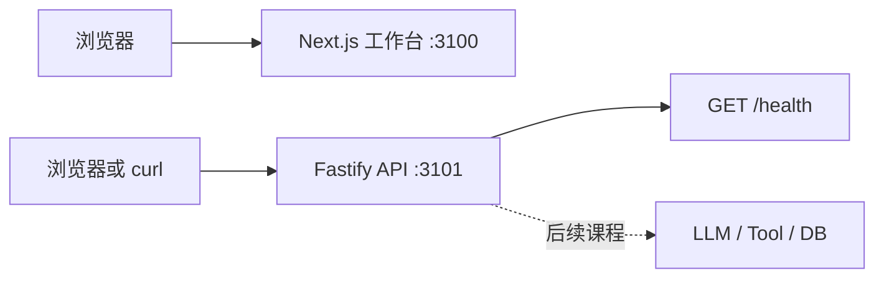

# L00：仓库体检与项目骨架

日期：2026-10-27。状态：**COMPLETED**。本课只建立可运行的前后端基础，不接模型或 Agent。

## 1. 本课目标与完成定义

1. 能检查原目录、Git 状态、Node/pnpm 版本，知道何时不能覆盖已有项目。
2. 能用一个命令启动 Next.js 工作台和 Fastify API，并说明两者职责。
3. 能调用 `GET /health`，确认正常响应与错误路径不同。
4. 能运行并解释 lint、typecheck、test、build 的作用和结果。

## 2. 先讲明白概念

传统后台前端已有页面、API 和业务数据边界。Agent 应用仍需要这些普通工程基础；模型只是以后接在服务端的一种不稳定外部依赖，不会替代浏览器、API、权限或测试。`health` 是进程与路由是否正常工作的最小探针，**不代表业务数据或模型可用**。

本课使用 pnpm workspace 管理两个独立应用。前端只显示静态占位状态；API 只注册一个只读路由。TypeScript 检查开发时类型，运行时请求校验将在真正有输入的后续课程加入。`lint` 发现代码规范与潜在错误，`test` 检查行为，`build` 验证可产出部署文件，彼此不能互相替代。

## 3. 在 AI Native Console 中的位置

- 输入：浏览器访问 `/`；命令行或浏览器请求 API `/health`。
- 输出：静态工作台 HTML；JSON `{ "status": "ok" }`。
- 主要文件：`apps/web/app/page.tsx`、`apps/api/src/app.ts`、`apps/api/src/index.ts`、`apps/api/src/app.test.ts`。
- 当前页面不调用 API；`/health` 也不检测模型、数据库或工具。

## 4. 关键架构与数据流

浏览器没有模型密钥，也没有直接执行敏感业务工具的入口。虚线部分目前不存在。

## 5. 实施步骤

1. 检查当前目录：原先仅有总控文档，没有 `.git`、`AGENTS.md`、README 或 `package.json`。本机 Node `v22.17.0`、pnpm `7.9.0`。在当前目录初始化 Git，保留总控文档。
2. 创建 `pnpm-workspace.yaml`、根脚本与两个应用的精确版本依赖；只安装本课使用的 Next.js、React、Tailwind、Fastify、TypeScript、ESLint、Vitest、tsx。
3. 在 `apps/web/app` 创建静态占位页；在 `apps/api/src` 分开定义应用与监听入口，使 API 可用 `inject()` 测试。Next.js 首次开发启动时自动生成了 `apps/web/AGENTS.md`，构建时补充了 Web 的 `tsconfig.json` 类型目录。
4. 加 `.gitignore`、`.env.example`、README 和课程跟踪文件；真实密钥不需要，也不创建真实 `.env`。
5. 执行安装、四项验证、启动与 HTTP 探测；首次 3000 端口冲突后改用 3100/3101 并复测。

## 一、没接触过 AI Agent 必须警惕的 5 大深水坑

这五项是全课程的通用风险。本课未进入模型链路，所以先明确未来的边界与可验证方式，不声称已经实现相关防护。

| 通用坑点 | 本课关联度 | 风险与触发条件 | 项目防护措施 | 本课测试 / 后续验证 |
| --- | --- | --- | --- | --- |
| 流式传输、Partial JSON 与 Generative UI | 暂不展开 | 模型流在 JSON 中间断开，页面若直接解析或执行会崩溃。 | 未来只把 partial 当展示数据，最终结果再完整校验；UI 固定容器。 | L00 页面不消费流；L03/L04 测 chunk 拆分、断流及布局稳定。 |
| 幻觉、无效工具调用与参数纠错 | 相关 | 模型提出未知工具或错误参数。 | 工具只能由服务端注册、校验和执行；不信任模型给出的权限。 | L00 API 只注册 `/health`，未知路由与错误方法均为 404；L05/L06 再测工具输入。 |
| Token、上下文窗口与“记忆失忆” | 暂不展开 | 历史对话过长或摘要覆盖当前业务事实。 | 未来按预算组装白名单上下文，当前事实来自业务源。 | L00 无对话数据；L07 测长对话和冲突条件。 |
| 长流程 Agent、越权与人工审批 | 相关 | 模型把未经批准的动作当作可执行命令。 | 浏览器只展示；未来服务端鉴权、审批和幂等。 | L00 无副作用业务路由；L10/L12 测未审批、越权和重复执行。 |
| 网络断开、用户取消与流恢复 | 暂不展开 | 前端断连后服务端仍计费或继续执行。 | 未来明确取消语义并传播 AbortSignal，恢复读取持久事件。 | L00 无流或长任务；L08/L14 测断开、取消和重连。 |

### 本课专项五大深水坑

| L00 专项 | 风险与触发条件 | 修复策略 | 本课测试与结果 |
| --- | --- | --- | --- |
| 环境差异导致“我电脑能跑” | Node/pnpm 版本或端口不同，安装或启动失败。 | 记录版本、锁文件、启动端口和验证命令；不自动升级用户环境。 | 实测 Node 22.17.0、pnpm 7.9.0；发现 3000 被占用，固定到 3100/3101 后页面和 API 可访问。 |
| 覆盖用户已有工程 | 脚手架命令重写现有代码。 | 先列目录、查 Git 与原文件，再增量创建。 | 创建前确认只有总控文档且不是 Git 仓库；总控文档仍在根目录。 |
| 把脚手架成功当成项目完成 | 文件存在但编译、路由或启动失败。 | 安装后跑 lint、typecheck、test、build，再发 HTTP 请求。 | 五项命令均 exit 0；HTTP 页面 200、health 200、未知路由 404。 |
| 密钥误提交 | 将 `.env` 或模型 Key 加入 Git。 | 只提交 `.env.example`；`.gitignore` 排除 `.env` 与 `.env.*`。 | `git check-ignore .env` 应输出 `.env`；L00 无模型 Key。 |
| AI Coding 代码未经审查 | 依赖、脚本、错误路径或前后端责任错误。 | 检查实际新增文件和依赖，写核心路由测试，并验证生产构建。 | 测试覆盖 GET 成功、未知路径和错误方法；lint/typecheck/build 均成功。 |

## 7. 代码讲解与关键设计决策

`createApp()` 只负责建 Fastify 应用和注册路由，`index.ts` 才监听端口。这样测试可以用 Fastify 官方的 `inject()` 在进程内发 HTTP 请求，不依赖端口，也不会误连其他服务。没有将 `/health` 写在 `index.ts` 的顶层监听逻辑中，因为那样测试需要启动真实进程，故障定位更慢。

Next.js App Router 的 `page.tsx` 是静态 Server Component，当前没有浏览器状态与业务请求，所以不引入全局状态库或客户端 JavaScript。Tailwind 只负责简单布局和响应式样式。API 返回状态字面量，未暗示数据库或模型就绪。

根目录 `pnpm-lock.yaml` 锁定实际解析版本；`package.json` 固定直接依赖版本。后续课程涉及 AI SDK 时，要重新核对官方文档和已安装版本。

## 8. 测试与验收

| 命令 / 检查 | 实际结果 |
| --- | --- |
| `pnpm install` | exit 0，解析 357 个包；3 个 workspace 项目。 |
| `pnpm lint` | exit 0，ESLint 无错误。 |
| `pnpm typecheck` | exit 0，API 与 Web 均通过。 |
| `pnpm test` | exit 0，1 个测试文件、3 个测试：GET `/health` 200 JSON；GET `/missing` 404；POST `/health` 404。 |
| `pnpm build` | exit 0；API TypeScript 构建完成；Next.js 16.4.3 编译并静态生成 `/`。 |
| `pnpm dev` | 首次因本机 3000 被占用导致 3001 冲突；改为 3100/3101 后两端 Ready。 |
| `curl http://127.0.0.1:3101/health` | HTTP 200，`{"status":"ok"}`。 |
| `curl http://127.0.0.1:3101/missing` | HTTP 404。 |
| `curl http://127.0.0.1:3100/` | HTTP 200、`text/html`。 |

手动验收：运行 `pnpm dev`，打开 `http://127.0.0.1:3100`，检查标题、L00 状态和三个标记“尚未接入”的模块；打开 `http://127.0.0.1:3101/health` 检查 JSON；再访问 `/missing` 确认 404。页面在手机宽度下应变为单列、文字不相互遮挡。此处页面视觉检查留给学习者完成，自动验证只覆盖响应与构建。

## 9. 常见坑位与排查

| 现象 | 原因 | 解决方法 |
| --- | --- | --- |
| 前端自动换端口后 API 启动失败 | 默认 3000 被占用，Next.js 自动选择了 API 原用的 3001。 | 使用当前固定的 3100/3101；如再冲突，先查占用，再同时调整脚本、API 端口和 README。 |
| `/health` 404 | 请求发到了前端端口，或方法不是 GET。 | 请求 `http://127.0.0.1:3101/health`，使用 GET；错误方法返回 404 是预期。 |
| 类型检查通过但页面无法打开 | 类型检查不会启动服务或覆盖运行时路由。 | 运行 `pnpm dev` 并用浏览器 / curl 实测。 |
| 把 `.env` 加入版本控制 | ignore 规则缺失或曾经被跟踪。 | 检查 `.gitignore` 与 `git check-ignore .env`；不要在示例文件填真实 Key。 |

## 三、模拟面试真实考场：核心考题与高质量对答

### Q1：为什么做 AI Agent 前先搭可运行骨架？

**推荐口头答案：** 因为 Agent 的模型调用和工具执行都建立在普通 Web 系统上。我先固定运行环境、前后端边界、启动命令和测试入口，确保后续出现失败时能判断是网络、服务、输入还是模型层的问题。在个人项目中，我目前完成的是 Next.js 静态工作台和 Fastify `/health`，并跑过 lint、类型检查、3 个路由测试和构建；这只能证明基础骨架可用，不能证明 Agent 功能已经完成。

**追问：** health 返回 200 是否代表模型和数据库健康？**回答边界：** 不代表，目前两者尚未接入；后续需要明确区分 liveness 和 readiness。

**不能夸大：** 不把脚手架说成企业级 Agent 已落地。

### Q2：前端和 Node API 应如何分工？

**推荐口头答案：** 浏览器负责输入、状态呈现与用户确认，服务端负责可信边界内的校验、授权和未来的模型与业务工具调用。前端不能保存模型 Key，也不能凭模型输出决定业务权限。现在项目的前端只渲染静态占位页面，Fastify 只提供健康接口；工具注册、鉴权和审批属于后续课程。我会用浏览器访问和 API 路由测试分别验证两端，避免把页面显示正常误认为 API 正常。

**追问：** 为什么不直接从浏览器调用模型供应商？**回答边界：** 浏览器中无法安全保存受保护的密钥，也不应绕过服务端业务策略。

**不能夸大：** 当前尚无实际授权实现，不能说已经防止越权。

### Q3：如何审查 AI Coding 生成的代码？

**推荐口头答案：** 我先检查原项目和版本，避免覆盖已有工作；再逐文件看依赖是否必要、脚本是否能运行、秘密是否会被提交、是否有失败路径。验证分层进行：lint 看静态规则，typecheck 看类型，测试看行为，build 看产物，最后用真实 HTTP 请求检查启动后的页面和 API。本课就发现默认端口和本机已有服务冲突，修改端口后重新请求页面与健康接口。这个过程比只看生成文件或一次“编译通过”更可信。

**追问：** 测试全绿还可能漏什么？**回答边界：** 当前没有自动浏览器视觉回归，也没有模型、权限或生产环境测试；要随功能风险补齐。

**不能夸大：** 不宣称脚手架已经经过生产级验证。

## 11. 本课面试表达

“我正在做一个 AI Native Console 个人学习项目。第一阶段先搭建 Next.js 工作台和 Fastify API，把启动、构建、类型检查与测试链路跑通。API 目前只有 `/health`，我验证了成功响应、未知路由和错误方法，也检查了前端页面实际可访问。这样后续接模型与业务工具时，可以先确认基础设施是否正常。目前还没有模型、Agent Loop、权限或审批实现，更没有生产上线数据。”

## 12. 复盘检查

请用自己的话回答：

1. `GET /health` 返回 200 能证明什么，又不能证明什么？
2. 为什么把 `createApp()` 和 `listen()` 分开？
3. lint、typecheck、test、build、HTTP 实测分别能发现哪类问题？

小练习：把 API 的 `/health` 返回对象暂时改成其他值，先运行 `pnpm test` 观察失败，再改回原值并重跑。不要把故意制造的失败保留在项目里。

验收 checklist：

- [x] 原文档被保留，Git 与依赖版本已记录。
- [x] 一条 `pnpm dev` 同时启动 Web 和 API。
- [x] `/health` 返回 200 JSON，两个异常路由返回 404。
- [x] install、lint、typecheck、test、build 实际执行成功。
- [x] 无模型 Key、无真实模型请求、无 Agent Loop。
- [ ] 学习者亲自打开页面并完成口头复盘。

## 13. 官方参考资料

核对日期：2026-10-27。以锁文件、已安装版本和实际编译结果为准。

- [Next.js App Router 安装与手动配置](https://nextjs.org/docs/app/getting-started/installation)：核对 Node 最低版本、`app/layout.tsx`、`page.tsx`、`next dev/build`。已核对项目安装的 Next.js 16.4.3 同包文档。
- [Fastify Routes](https://fastify.dev/docs/latest/Reference/Routes/) 与 [Testing](https://fastify.dev/docs/latest/Guides/Testing/)：核对 `get()` 与 `inject()`；已核对项目安装的 Fastify 5.12.7 同包文档。
- [Tailwind CSS + Next.js](https://tailwindcss.com/docs/installation/framework-guides/nextjs)：本课 `@tailwindcss/postcss` 与 CSS 导入由实际构建验证。
- [Node.js 官方文档](https://nodejs.org/api/)：L00 只使用 Node 进程与环境变量；未来涉及流与取消时按对应版本重新核对。

## 14. 课后更新

已更新 `docs/training/PROGRESS.md`、`CURRICULUM.md`、`interview-question-bank.md` 和 README。下一课是 L01，须由用户检查本课后再开始；本轮未提前实现 L01 的模型概念练习或后续功能。
