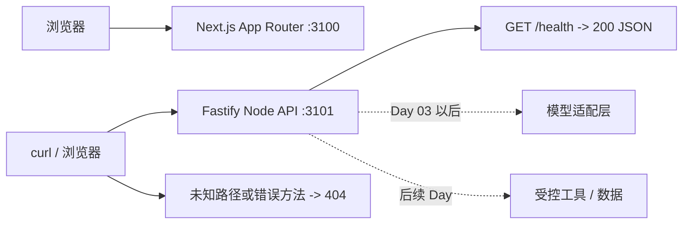

# Day 01：仓库体检与最小全栈骨架

日期：2026-10-27。状态：**COMPLETED**。本课在已有 L00 工程上独立复测并调整课程标识；旧 L00 课件保留为历史资料。本课没有接入模型、业务数据库、Agent 或审批。

## 1. 目标、前置知识与完成定义

前置：会用 React/TypeScript 和终端；无需 AI Agent 经验。完成后应能：

1. 列出已有仓库文件、Git 状态与 Node/pnpm 版本，说明为什么不能直接覆盖现有工程。
2. 用一个命令启动静态 Next.js 工作台和 Fastify API，讲清浏览器与服务端责任。
3. 请求 `GET /health`，区分 200、未知路由 404 与错误方法 404。
4. 解释并实际运行锁文件安装、lint、typecheck、test、build；不会把 health 200 说成模型可用。

真实项目先要有可运行且可复测的基础设施。否则以后模型超时、流中断或工具失败时，连问题属于页面、HTTP、服务端还是模型都难定位。

## 2. 核心概念与执行流程

**AI Agent 仍是普通软件系统的一部分。** 浏览器负责显示和输入；Node API 是未来校验、鉴权、模型密钥和业务工具的可信入口。模型不会替代这些边界。本日只验证两个最外层进程，不把模型、工具或数据库伪装成已就绪。



`/health` 当前是进程路由的存活检查，不是模型、数据库或外部依赖的 readiness 检查。Next.js 的静态页目前不请求 API。TypeScript 是编译期约束，后续外部输入仍须单独做运行时校验。

## 3. 文件、实施步骤与关键代码

仓库体检：当前工作目录为 `ai_native_console`；Git 已初始化，但所有文件仍未提交。已有根 README、pnpm workspace、锁文件、`apps/web`、`apps/api` 和旧 L00 课件，另有两份本次指定的根目录指令。Node `v22.17.0`，pnpm `7.9.0`。已读取 `apps/web/AGENTS.md`；其中要求按已安装 Next.js 文档检查当前版本 API。没有根目录 AGENTS 或已有架构说明文件。

| 文件 | Day 01 的作用和处理 |
| --- | --- |
| `apps/web/app/page.tsx` | 复用静态 Dashboard，只将旧 L00 标签及模块 Day 对应改为 40 Day 课程编号。 |
| `apps/web/app/layout.tsx`、`globals.css` | 沿用 App Router 根布局和 Tailwind 样式；无业务请求。 |
| `apps/api/src/app.ts`、`index.ts` | 沿用 Fastify 应用工厂与独立监听入口，`GET /health` 只返回 `status: ok`。 |
| `apps/api/src/app.test.ts` | 沿用 Fastify `inject()` 测试正常路由和两个错误路径。 |
| 根 `package.json`、`pnpm-lock.yaml`、`.env.example`、`.gitignore` | 沿用锁定依赖、脚本、端口示例与密钥排除规则。 |
| `docs/training/*`、根 README | 建立 40 Day 管理文件和当前真实进度。 |

具体操作顺序：检查文件与 Git → 先建立 40 Day 课程地图和覆盖矩阵 → 复用现有骨架 → 更新页面课程标识 → 运行验证 → 记录结果。没有运行脚手架生成器，也没有覆盖用户已有代码。

核心 API 代码位于 `apps/api/src/app.ts`：

```ts
export function createApp() {
  const app = Fastify({ logger: true });
  app.get("/health", async () => ({ status: "ok" as const }));
  return app;
}
```

把 `createApp()` 与 `listen()` 分开，让测试可以用 `app.inject()` 在进程内请求路由，不占端口、不误连其他服务。未把测试只写成“组件/文件存在”检查，因为那不能证明真实响应状态。静态页面保留 Server Component；本日没有跨组件状态，所以不安装 Zustand。测试覆盖的只是最小 HTTP 行为，不暗示权限、工具或模型已验证。

## 一、没接触过 AI Agent 必须警惕的 5 大深水坑

| 通用坑点 | 本课关联 | 风险/触发条件 | 当前防护与测试；后续责任 |
| --- | --- | --- | --- |
| 流式、Partial JSON、Generative UI | 暂不展开 | 网络可在 JSON 中途结束，直接解析或执行会失败。 | Day 01 不接流；Day 05–10 测拆帧、partial 最终校验和布局。 |
| 幻觉、无效工具调用、参数纠错 | 相关 | 模型可提议不存在或越权的工具。 | 当前 API 仅注册 `/health`，未知路由 404；Day 11–15 才做服务端 allowlist、Schema 与授权。 |
| Token、上下文窗口与记忆 | 暂不展开 | 长会话超预算或摘要覆盖当前事实。 | 当前无对话；Day 16–18 建预算、白名单与事实优先测试。 |
| 长流程、越权与 HITL | 相关 | 未审批就执行高危动作或重复副作用。 | 当前无写操作；Day 21–30、37 实现状态、审批、鉴权与幂等。 |
| 网络断开、取消与恢复 | 暂不展开 | 浏览器断开后服务端可能继续运行。 | 当前无长请求；Day 07/30 验证取消传播和事件恢复，不把 abort 当事务回滚。 |

### 本课专项五大深水坑

| 专项失效场景 | 触发条件 | 表现及原因 | 处理方案 | 测试方法与本轮结果 |
| --- | --- | --- | --- | --- |
| 环境差异导致“我电脑能跑” | Node/pnpm 不匹配或端口占用 | 安装、构建或服务启动失败；默认端口可能与其他项目冲突。 | 记录 Node/pnpm/锁文件，固定 3100/3101，保留可重复启动命令。 | 实测 Node 22.17.0、pnpm 7.9.0；`pnpm install --frozen-lockfile` 成功；两端启动并 HTTP 200。 |
| 覆盖已有工程 | 对非空目录直接运行脚手架 | 原文件和改动丢失；缺少仓库体检。 | 先看 `git status`、文件清单、AGENTS、README、package，再做增量修改。 | 本轮检查到旧 L00 工程和两份根指令；旧课件与代码均保留。 |
| 把脚手架成功当项目完成 | 只生成文件不运行 | 页面或 API 可能编译失败，错误路径无人验证。 | 分别执行 lint、typecheck、test、build 和真实 HTTP 请求。 | 五项命令 exit 0；3 个 API 用例通过，页面/health 200，异常请求 404。 |
| 密钥误提交 | 把 Key 放 `.env`、`NEXT_PUBLIC_` 或 Git | 浏览器或仓库泄漏凭据；前端环境变量可公开。 | L00/Day 01 无 Key；`.gitignore` 排除 `.env*`，仅保留示例文件。 | `git check-ignore .env` 输出 `.env`；未新增模型供应商包或密钥。 |
| AI Coding 代码未经审查 | 只相信生成结果或一次编译 | 依赖过多、边界误解、错误方法仍被接受。 | 逐文件核对依赖、路由、脚本与前后端职责；补异常路径测试。 | `GET /health` 200 JSON、`GET /missing` 404、`POST /health` 404；构建成功。 |

## 5. 常见问题排查

| 现象 | 原因 | 解决方式 |
| --- | --- | --- |
| API 起不来、提示 EADDRINUSE | 端口被其他服务占用 | 当前 Web 固定 3100，API 默认 3101；检查占用后再调整端口和文档。 |
| `/health` 返回 404 | 请求到前端端口，或用了 POST | 使用 `GET http://127.0.0.1:3101/health`。 |
| 类型检查通过但页面无法打开 | typecheck 不运行 HTTP 服务 | `pnpm dev` 后做真实请求。 |
| `.env.example` 中出现真实 Key | 示例文件被误当密钥存储 | 仅放非敏感端口示例；真实密钥留在受保护的服务端环境。 |

## 6. 测试计划、实际结果与证据

本轮**实际执行**，不是引用旧 L00 的结论：

| 命令或请求 | 实际结果 | 对应路径/证据 |
| --- | --- | --- |
| `pnpm install --frozen-lockfile` | exit 0；锁文件已最新，3 个 workspace 项目。 | 根 `pnpm-lock.yaml` |
| `pnpm lint` | exit 0，无 ESLint 错误。 | 根脚本与 `eslint.config.mjs` |
| `pnpm typecheck` | exit 0，API/Web 均通过。 | 两端 `tsconfig.json` |
| `pnpm test` | exit 0，Vitest 1 个文件、3 个测试全部通过。 | `apps/api/src/app.test.ts` |
| `pnpm build` | exit 0，API 编译完成；Next.js 16.4.3 编译成功并静态生成 `/`。页面改为 Day 01 后已重跑。 | 两端构建脚本；生成目录被 ignore |
| `pnpm dev` | Next.js Ready 于 `127.0.0.1:3100`，Fastify 监听 `127.0.0.1:3101`。 | 根启动脚本 |
| `GET /` | HTTP 200，`text/html`；页面中核对到 `Day 01`。 | `apps/web/app/page.tsx` |
| `GET /health` | HTTP 200，`{"status":"ok"}`。 | `apps/api/src/app.ts` |
| `GET /missing`、`POST /health` | 都是 HTTP 404。 | `apps/api/src/app.test.ts` |
| `git check-ignore .env` | 输出 `.env`。 | 根 `.gitignore` |

**未执行：** 浏览器移动端截图/视觉回归、模型调用、Agent、鉴权与生产部署测试；这些不属于 Day 01 已完成能力。旧 L00 初次启动时曾遇到 3000/3001 端口冲突，现有固定端口已在本轮复测可用。

## 7. 量化验收与手动步骤

验收门槛：1 个前端页面返回 200、1 个 API 健康路由返回 200 JSON、2 个错误请求返回 404、3/3 API 测试通过，install/lint/typecheck/test/build 都 exit 0；无真实 Key 和未使用的 AI 包。

1. 在仓库根目录运行 `pnpm dev`；本机可直接打开 <http://127.0.0.1:3100>，确认标题、Day 01 标签、三个“尚未接入”模块。
2. 打开 <http://127.0.0.1:3101/health>，确认显示 `{"status":"ok"}`；再访问 `http://127.0.0.1:3101/missing`，确认 404。
3. 将浏览器缩窄到手机宽度，检查状态区和模块区变成单列、文字不重叠。该视觉步骤留给学习者亲自确认，不能记成自动测试已通过。

验收清单：

- [x] 检查并保留已有工程、旧课件和两份指令。
- [x] 40 Day 总表与逐项覆盖矩阵先于 Day 01 课件完成。
- [x] 双端启动，页面和 health 200，异常请求 404。
- [x] 锁文件安装、lint、typecheck、3 项测试和 build 实测通过。
- [x] `.env` 被忽略，未引入模型、Agent 或 Day 02 功能。
- [ ] 学习者完成手机宽度视觉检查和口头复盘。

## 三、模拟面试真实考场：核心考题与高质量对答

### Q1：为什么先搭可运行的全栈骨架，而不是直接写 Agent？

**推荐回答：** Agent 仍依赖普通 Web 链路。先把运行环境、前后端边界、启动和测试固定下来，后续接入模型时才能区分基础设施、HTTP、模型或工具故障。我在这个个人项目的 Day 01 复用了 Next.js 静态工作台和 Fastify 健康接口，重新跑了锁文件安装、lint、类型检查、3 个路由测试、构建及 HTTP 请求。当前只证明骨架可运行，还没有 Agent 行为。

**面试官追问：** health 返回 200，模型是不是就可用？

**追问回答：** 不是。当前 health 只说明 Fastify 路由能返回 JSON。模型和数据库都未接入；将来可区分进程存活和依赖就绪，并单独验证。

**常见错误答案及原因：** “前端打开了，就证明全链路健康。”页面与 API 是两个进程，页面正常也可能 API 故障，更不能说明模型可用。

**不能夸大：** 不能把个人骨架说成企业 Agent 已上线。

### Q2：浏览器和 Node API 在 AI 应用中各负责什么？

**推荐回答：** 浏览器负责输入、展示和用户确认；Node API 承担未来模型密钥、输入校验、身份授权和受保护工具的执行边界。模型提出工具调用不等于有权执行工具。当前 Day 01 前端只有静态占位，服务端只有 `/health`，没有真实鉴权或工具。我分别用页面请求与 Fastify 路由测试验证了两端。

**面试官追问：** 为什么不能直接把模型 Key 放在 `NEXT_PUBLIC_` 环境变量？

**追问回答：** 这类变量会进入浏览器可见的客户端代码，无法作为秘密存储。模型调用应走服务端，并在那里进行权限与业务约束。

**常见错误答案及原因：** “写在 `.env` 就安全。”`.env` 只是文件位置；若变量公开给浏览器或被提交，仍会泄露。

**不能夸大：** 当前未实现鉴权，不能说已防止越权。

### Q3：怎样审查 AI Coding 生成的脚手架？

**推荐回答：** 我会先读现有仓库与规则，防止覆盖；再检查依赖是否必要、路由和端口是否一致、秘密是否被忽略，并给关键行为写失败路径测试。验证时分别跑 lint、typecheck、test、build，最后真实启动并发 HTTP 请求。本轮测试确认 health 的 200 JSON 和两个 404；过去端口冲突也通过固定端口解决。测试范围要如实描述。

**面试官追问：** 四项命令全绿，为什么还要手动访问页面？

**追问回答：** 静态检查和构建不能证明两个进程按预期监听、路由返回正确内容，也无法自动覆盖手机宽度视觉问题。本轮做了 HTTP 实测，视觉回归仍未自动化。

**常见错误答案及原因：** “能编译就能用。”编译不检查运行时端口、HTTP 状态、环境变量或视觉布局。

**不能夸大：** 不能说经过生产级故障验证。

## 9. 本课小结、复盘与下一课依赖

最需要记住的三点：**先检查再修改；浏览器与服务端有明确安全边界；测试、构建和真实 HTTP 验收各检查不同风险。**

请用自己的话回答：

1. `/health` 返回 200 可以证明什么，不能证明什么？
2. 为什么 `createApp()` 与 `listen()` 分开有利于测试？
3. TypeScript、测试、构建和真实 HTTP 请求分别能发现哪类问题？

小练习：临时把 `/health` 的 `status` 改成另一个值，观察 `pnpm test` 失败；随后改回并重测，不保留练习改动。

**Git commit 建议：** 完成人工检查后，可把 Day 01 地图与骨架作为一次独立提交，建议消息 `docs: lock 40-day curriculum and verify day 01`。本轮未代替用户提交。

**下一课依赖：** Day 02 才引入环境配置校验、共享 API 契约、统一错误体和 requestId。需要用户明确指示后才开始；本轮停在 Day 01。

## 10. 官方参考与课后更新

核对日期 2026-10-27：已读取项目安装的 Next.js 16.4.3 文档中 App Router 安装与 `page.tsx` 约定，并以本轮 typecheck/build 验证；Fastify `get()`/`inject()` 用法按项目安装的 5.12.7 文档与测试验证。参考链接：[Next.js 安装](https://nextjs.org/docs/app/getting-started/installation)、[Next.js Page 文件约定](https://nextjs.org/docs/app/api-reference/file-conventions/page)、[Fastify Routes](https://fastify.dev/docs/latest/Reference/Routes/)、[Fastify Testing](https://fastify.dev/docs/latest/Guides/Testing/)、[Tailwind + Next.js](https://tailwindcss.com/docs/installation/framework-guides/nextjs)。后续 AI SDK 与 LangGraph API 只能以届时安装版本和官方文档为准。

已更新 [课程总表](../CURRICULUM.md)、[覆盖矩阵](../COVERAGE_MATRIX.md)、[进度](../PROGRESS.md)、[决策日志](../DECISION_LOG.md)、[题库](../interview-question-bank.md) 和根 README。待解决：独立 Gemini 原始大纲未提供、移动端视觉未自动验收；其余版本敏感问题已排入对应 Day。
