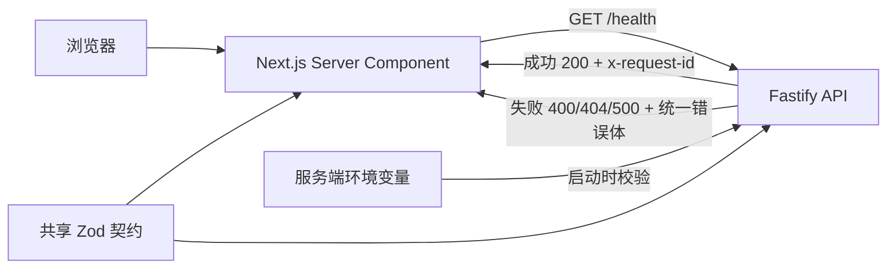

# Day 02：开发环境、API 契约与错误边界

日期：2026-10-27。状态：**COMPLETED**。Day 01 已验收；用户曾要求先实施 Day 03，本课随后补齐。Day 04 未开始。

## 1. 本课目标、前置知识与完成定义

前置：理解浏览器、Next.js 服务端与 Fastify API 是不同执行环境；Day 01 的 `/health` 和构建脚本可运行。对已有 5 年 React/TypeScript 经验的学习者，本课最关键的转换是：**TypeScript 类型在运行时消失，网络返回与环境变量仍要逐项验证。**

真实项目需要稳定的接口约定。调用失败时，前端要知道是输入错误、路径错误还是服务故障；排查时，客户端和服务端要能用同一个请求 ID 对齐记录。无效配置必须在启动时失败，不能等第一次用户请求才暴露。

完成定义：Web/API 共用 Zod 契约；API 启动配置有默认值与明确失败；每个 API 响应有服务端生成的 UUID；400/404/500 返回统一错误体；Dashboard 能真实读取并校验 `/health`，失败时显示不可用；测试、lint、typecheck 和 build 均通过。

## 2. 核心概念与执行流程

**契约**描述 HTTP 边界的实际数据形状。`HealthResponse` 类型方便编辑器提示；`healthResponseSchema.parse()` 和 `safeParse()` 才会在运行时拒绝坏数据。**requestId** 是一次请求的关联标识，不是登录身份或幂等键。为避免把客户端伪造的 ID 当作可信日志主键，Fastify 忽略传入的 `request-id`，自行生成 UUID，并在响应头 `x-request-id` 返回。失败时错误体也带同一个 ID。



Next.js 通过 `connection()` 在请求时渲染健康状态，再由服务端 `fetch` 访问 API。这个设计无需浏览器跨域直连，也不会把 `API_INTERNAL_URL` 作为 `NEXT_PUBLIC_` 配置暴露。健康检查失败不会阻断 Dashboard，页面会明确显示“暂不可用”。

## 3. 具体文件、步骤与关键代码

| 文件 | 作用 |
| --- | --- |
| `packages/contracts/src/index.ts`、包配置 | 同一份健康响应、空查询、错误体、错误码与 UUID Schema，生成声明供 Web/API 使用。 |
| `apps/api/src/config.ts` | 校验 `API_HOST`、`API_PORT`；缺省使用本地值，非法端口在监听前失败，错误只列字段名。 |
| `apps/api/src/app.ts` | 服务端生成 requestId、响应头、统一 400/404/500、严格验证 `/health` 查询。 |
| `apps/api/src/index.ts` | 读取被 Git 忽略的 API `.env.local`，配置通过后才监听；启动失败不输出环境值。 |
| `apps/web/lib/api-health.ts`、`app/page.tsx` | Next 服务端以 2 秒上限请求 API，运行时校验响应体和 UUID，显示连接状态与可换行的 ID。 |
| `apps/api/src/*.test.ts`、`apps/web/lib/api-health.test.ts` | 配置、请求 ID、错误脱敏和前端无效响应/断网等边界测试。 |
| `.env.example`、`apps/*/.env.example`、工作区/脚本/锁文件 | 变量示例、共享包构建顺序和可复现依赖。 |

核心服务端代码：

```ts
const app = Fastify({ requestIdHeader: false, genReqId: () => randomUUID() });
app.addHook("onRequest", async (request, reply) => {
  reply.header("x-request-id", request.id);
});
```

`requestIdHeader: false` 表示不信任客户端提交的 ID。`setErrorHandler` 把已知无效请求映射为 400、未知内部异常映射为 500；500 的公开消息固定为 `Internal server error`。`setNotFoundHandler` 返回同形状的 404。健康端点只接受空查询，`/health?unexpected=1` 会返回 `VALIDATION_ERROR`。

统一错误示例（ID 每次不同）：

```json
{"error":{"code":"VALIDATION_ERROR","message":"Invalid query parameters","requestId":"3cfd913f-d30c-41b8-a1c3-11c0c6e5c0ba"}}
```

Web 对 200 响应也会校验 `{"status":"ok"}` 和 `x-request-id` 是否符合共享 Schema。只凭 HTTP 200 或 TypeScript 类型都不能证明远端实际遵守契约。共享包先构建，再供两个应用读取生成的 JavaScript 和类型声明；根脚本负责这个顺序。

## 一、没接触过 AI Agent 必须警惕的 5 大深水坑

| 通用深水坑 | 本课关联 | 触发条件与风险 | 本课防护、测试与未来边界 |
| --- | --- | --- | --- |
| 流式、Partial JSON 与 Generative UI | 暂不展开 | 把未来的部分结果当完整 JSON，会误展示或误执行。 | 本课只处理完整 `/health` JSON 并最终校验；流式/partial 留给 Day 05–10。 |
| 无效工具调用与参数纠错 | 相关 | 误以为类型声明能阻止运行时坏参数，未来会把错误工具输入执行。 | 空查询用 Zod 严格校验并测 400；工具 Schema、授权和有界纠错留给 Day 11–15。 |
| Token 与上下文记忆 | 暂不展开 | 将不受限用户输入送到模型会增加成本和泄露面。 | 本课没有模型请求入口；Day 17–18 才做预算与裁剪。 |
| 长流程、越权与 HITL | 相关 | 将 requestId 当身份或审批凭据会导致越权。 | 明确 requestId 只用于排查；鉴权、资源归属和审批留给 Day 13/24–25/37。 |
| 断流、取消与恢复 | 相关 | 健康检查无界等待会拖住页面。 | Web 健康请求有 2 秒超时并在失败时降级；流式取消、任务恢复留给 Day 07/30。 |

## 5. 本课专项五大深水坑

| 失效场景 | 触发条件与表现 | 原因 | 处理方案 | 测试方法与结果 |
| --- | --- | --- | --- | --- |
| 默认端口类型错误 | 未配置 `API_PORT`，监听收到字符串而不是数字。 | Zod 默认值若放在转换后，会跳过转换。 | 在预处理阶段补默认字符串，再校验并转数字。 | 第一轮测试真实失败；修复后缺省返回 `3101` 数字，类型检查和测试通过。 |
| 无效配置静默启动 | `API_PORT=abc`、`0`、越界或空 host。 | 环境变量是未验证的字符串。 | 启动前校验；仅记录字段名，不记录原值。 | 单元测试覆盖边界；`API_PORT=abc node apps/api/dist/index.js` 实际 exit 1，日志 `CONFIG_ERROR`/`API_PORT`。 |
| 客户端伪造关联 ID | 请求带 `request-id: client-controlled`。 | 直接信任外部头部会污染关联日志。 | 禁用客户端 requestIdHeader，服务端生成 UUID。 | 测试确认响应 ID 是 UUID 且不等于伪造值；相邻请求 ID 不同。 |
| 错误结构漂移或泄露内部细节 | 404/500 返回不同格式，异常文本含内部诊断值。 | 默认框架错误与业务错误各走一条路径。 | 错误处理器和 not-found 处理器共用 Schema；500 只给固定文案。 | 400/404/500 契约测试通过，私有异常文本未进入响应体。 |
| HTTP 200 被误认为 API 可用 | API 返回坏 JSON、缺 ID、非 200 或网络断开。 | TypeScript 不验证 HTTP 响应。 | Next 服务端检查状态码、Zod 响应体和 UUID；失败显示不可用。 | Web 6 个测试覆盖有效响应、坏响应、坏 ID、503、断网和非法服务地址。 |

## 6. 测试计划、实际结果与验收

| 实际命令或请求 | 实际结果 |
| --- | --- |
| `pnpm install` | exit 0；4 个 workspace，锁文件已更新。 |
| `pnpm lint` | exit 0；覆盖 `apps` 与 `packages`。 |
| `pnpm typecheck` | exit 0；contracts、API、Web 均通过。 |
| `pnpm test` | exit 0；API 19/19、Web 6/6，总计 **25/25**。 |
| `pnpm build` | exit 0；contracts 与 API 编译，Next 16.4.3 生产构建通过，首页为请求时渲染。 |
| `API_PORT=abc node apps/api/dist/index.js` | exit 1；只记录 `CONFIG_ERROR` 与 `API_PORT`，不输出配置值。 |
| `GET http://127.0.0.1:3101/health` | 实际 200、`{"status":"ok"}`，响应头含 UUID `x-request-id`。 |
| `GET http://127.0.0.1:3101/health?unexpected=1` | 实际 400、`VALIDATION_ERROR`，错误体 ID 与响应头一致。 |
| `GET http://127.0.0.1:3100/` | 实际 200；HTML 显示 `Day 02`、`API 连接` 与 `已连接`。 |

第一轮 `pnpm typecheck` 与 `pnpm test` 未通过：前者指出 `genReqId` 函数签名和 Zod 默认值类型不正确，后者发现缺省端口是字符串。修复后重新运行上述命令通过；首次失败不计入最终通过结果。

可量化验收清单：

- [x] 无 API 环境变量时使用 `127.0.0.1:3101`；非法端口在监听前拒绝。
- [x] 成功/400/404/500 的响应头有服务端 UUID；错误体 ID 与头一致。
- [x] Web 和 API 使用同一份运行时契约；坏响应不会显示“已连接”。
- [x] 25/25 测试、lint、typecheck、build，以及真实 HTTP 200/400 完成。
- [ ] 手机宽度视觉检查未自动执行，建议按下方步骤手动确认换行与布局。

手动验收：

1. 根目录运行 `pnpm dev`，打开 <http://127.0.0.1:3100/>；“API 连接”应显示“已连接”和请求 ID。窄屏时 ID 应换行，不压住其他内容。
2. 访问 <http://127.0.0.1:3101/health>，应看到 `{"status":"ok"}`；用 `curl -i 'http://127.0.0.1:3101/health?unexpected=1'` 核对 400 错误体与响应头 ID 相同。
3. 单独停止 API 后刷新页面，应显示“暂不可用”；重新启动 API 后再刷新，应恢复“已连接”。该离线/恢复交互尚未做浏览器自动化测试，已有 Web 单元测试覆盖网络失败分支。

本课没有对 DeepSeek 发起请求。Day 03 的服务端 smoke 能力仍在，但尚无用户聊天 API、模型错误分类、鉴权或流式调用。requestId 不是 traceId、sessionId 或幂等键。可查证的证据在本课 API/Web 测试、实际 HTTP 输出和构建输出中；没有截图或性能报告。

## 三、模拟面试真实考场：核心考题与高质量对答

### Q1：TypeScript 已经有类型，为什么 API 还要用 Zod？

**推荐回答：** TypeScript 只在编译时检查本项目源码，网络响应和环境变量在运行时仍可能是任意值。我把健康响应与错误响应定义在共享包中，让 Web/API 复用类型和 Zod Schema。Web 在收到 HTTP 200 后仍用 Schema 验证响应体和请求 ID；API 启动时验证端口范围，非法值直接失败。本课测试覆盖坏响应、坏配置和无效查询。

**追问：** 共享类型是否已经保证前后端永远兼容？**追问回答：** 没有。独立部署、旧版本客户端或代理都可能返回不同内容，所以边界仍要运行时解析，并用兼容性测试约束改动。

**常见错误答案及原因：** “TS 类型会校验 fetch JSON。”`response.json()` 来自网络，声明类型并不会执行校验。

### Q2：你如何设计错误响应和 requestId？

**推荐回答：** 这套 API 的错误体固定为 `error.code/message/requestId`，400、404、500 都走同一契约。Fastify 自行生成 UUID，响应头和错误体使用同一个值，客户端伪造 `request-id` 不会被接受。500 只返回通用消息，避免将内部异常内容暴露给页面；我用注入测试验证了头体一致与异常脱敏。

**追问：** requestId 能拿来做鉴权或防重复执行吗？**追问回答：** 不能。它用于关联排查；身份验证、资源归属和幂等键需要各自的服务端机制和测试。

**常见错误答案及原因：** “只要客户端传一个 UUID 就可信。”外部头部可伪造，不能作为安全凭据或可信日志主键。

### Q3：API 暂时不可达时 Dashboard 如何表现？

**推荐回答：** Next.js Server Component 在请求时向 Fastify `/health` 发起服务端请求，有 2 秒超时；它检查 HTTP 状态、响应体 Schema 和 UUID 头部。失败时 Dashboard 仍能渲染，并显示“暂不可用”，不把健康检查异常抛给整页。Web 单元测试覆盖断网、503、坏数据和缺失 ID；实际页面在 API 可用时显示“已连接”。

**追问：** `/health` 成功是否证明 DeepSeek 和所有业务功能可用？**追问回答：** 不能。这里的健康检查只证明基础 API 链路；模型要单独 smoke，业务工具和数据库也要各自验收。

**常见错误答案及原因：** “页面能打开就说明后端没问题。”Next.js 页面和 Fastify 是两个进程，页面可能在 API 失败时仍正常返回 200。

## 9. 小结、复盘、Git 建议与下一课依赖

最需要记住的三点：**类型不等于运行时校验**；**requestId 只关联排查，不提供权限**；**API 失败也要有稳定的页面状态与错误契约**。

请用自己的话回答：1. 为什么同一份 Zod Schema 仍不能替代真实 HTTP 测试？2. 如果客户端发来一个看似合法的 UUID，服务端为什么还要自己生成 requestId？3. 当 `/health` 成功但模型不可用时，页面和面试表达应如何区分这两件事？

Git commit 建议：只提交 `packages/contracts`、API/Web 代码、锁文件、`.env.example` 和课程文档，提交信息可用 `feat: complete Day 02 API contracts and error boundaries`。Git 忽略的 `apps/api/.env.local` 继续留在本机；本轮没有创建提交。对话中出现过的旧 DeepSeek Key 仍建议轮换。

Day 04 依赖：在这个错误与请求 ID 契约上设计非流式问答入口，再分别验证 Mock、真实供应商失败、超时和输出限制。本轮止于 Day 02，不自动进入 Day 04。

## 10. 参考与版本核对

核对日期：2026-10-27。项目实际锁定 `fastify@5.12.7`、`zod@4.6.7`、`next@16.4.3`。Fastify 安装包自带 `docs/Reference/Server.md` 的 `requestIdHeader`/`genReqId` 说明与 `docs/Reference/Errors.md` 的错误处理说明，Next 安装包自带 `dist/docs/01-app/03-api-reference/04-functions/connection.md` 和 `fetch.md`；对应官方在线入口：[Fastify Server](https://fastify.dev/docs/latest/Reference/Server/)、[Next.js connection](https://nextjs.org/docs/app/api-reference/functions/connection)、[Zod](https://zod.dev/)。最终可执行行为以本课编译、测试和真实 HTTP 结果为准。
