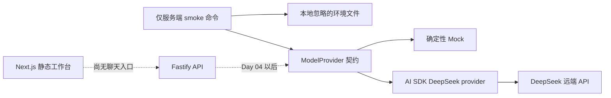

# Day 03：DeepSeek 模型服务适配层与密钥安全

日期：2026-10-27。状态：**COMPLETED**。用户明确要求先做 Day 03；本课实施当时 Day 02 标为 `DEFERRED`，统一 API 契约、requestId 和错误边界尚未完成。这些内容后来已在 [Day 02 补课](day-02-api-contracts.md)中完成。本课只接服务端 provider 与命令行连通性检查，不开放聊天接口或 Agent Loop。

## 1. 本课目标与完成定义

前置：Day 01 的 Node/Fastify 骨架可启动；按原路线本应先完成 Day 02。本轮只补了 Day 03 必需的密钥与模型 ID 校验，不把 Day 02 记为完成。

1. 能解释模型供应商适配层：业务代码面向统一 `generate(prompt): Promise<string>` 契约，Mock 和 DeepSeek 有相同返回形状。
2. 无 Key 时仍可运行 Fastify 与确定性 Mock 测试；真实调用只在服务端读取密钥。
3. 使用官方当前模型 ID 完成一次受控短回复检查，明确这不是完整聊天流程。
4. 能给出实际测试、构建与密钥隔离证据，不把一次成功请求当成生产可靠性证明。

## 2. 先讲明白概念与项目位置

**Provider** 是模型供应商接入层。它负责把应用的生成请求转给具体模型服务，返回同一形状的结果。Mock Provider 是本地可重复的替身，帮助在没有密钥、网络或额度时开发测试；真实 Provider 用 AI SDK 的 `@ai-sdk/deepseek` 调用 DeepSeek。Mock 测试验证应用契约，不验证 DeepSeek 平台可用；后者要另做真实连通性检查。

安全边界：前端没有 `DEEPSEEK_API_KEY`，`/health` 不发模型请求。密钥保存在 Git 忽略的 `apps/api/.env.local`，权限设为 `600`；示例文件只有占位符。用户先前在对话中给出的密钥仍应尽快轮换，轮换后更新本地文件。

## 3. 实施步骤、文件与设计决策

| 文件 | 本课改动与原因 |
| --- | --- |
| `apps/api/src/model-provider.ts` | 统一 Mock/DeepSeek 契约；Zod 校验配置与 prompt；模型 ID 白名单；真实生成设 64 token 上限、零自动重试、20 秒取消。 |
| `apps/api/src/model-provider.test.ts` | 验证 Mock 确定性、无效 prompt、缺密钥、非法模型与返回契约不含密钥。 |
| `apps/api/src/deepseek-smoke.ts` | 只从服务端本地环境读取密钥，发一次短请求，输出状态、模型、短回复和单次耗时；失败只输出错误类型/状态码。 |
| `apps/api/.env.example`、`.env.local` | 示例文件可提交；真实本地文件被 Git 忽略，不展示或输出其内容。 |
| `apps/api/package.json`、`pnpm-lock.yaml` | 锁定 `ai@7.0.154`、`@ai-sdk/deepseek@3.0.74` 和 peer 依赖 `zod@4.6.7`；增加手动 smoke 命令。 |
| `apps/api/tsconfig.build.json` | 构建所有非测试服务端源码，使适配器和 smoke 脚本进入构建产物。 |
| `apps/web/app/page.tsx` | 课程状态显示 Day 03 和“仅服务端已验证”，不宣称网页聊天可用。 |

核心代码：`createModelProvider({kind:"mock"})` 不需要 Key；`createModelProvider({kind:"deepseek", apiKey, model})` 创建当前官方 provider。外部环境值视为 `unknown` 并通过 Zod 解析，缺密钥或非法模型在发网络请求前失败。没有直接写 `fetch("https://api.deepseek.com/...")`，因为 AI SDK 已提供版本化的 DeepSeek provider；未来模型调用代码仍可复用统一接口。

官方 provider 文档指出 `deepseek-chat` 和 `deepseek-reasoner` 别名已退役。本课固定 `deepseek-v4-flash`，并只允许 `deepseek-v4-pro` 作为可选配置；不把示例中的旧模型名当作永久有效 API。

## 一、没接触过 AI Agent 必须警惕的 5 大深水坑

| 通用坑点 | 本课关联 | 风险/触发条件与防护 | 本课测试/后续验证 |
| --- | --- | --- | --- |
| 流式、Partial JSON 与 Generative UI | 暂不展开 | DeepSeek provider 可流式生成，但本课只做短文本连通性；不能把未来 partial 当完整结果。 | 本课未测试流；Day 05–10 验证协议、EOF 与安全组件。 |
| 无效工具调用与参数纠错 | 相关 | 模型输出不是可执行权限；本课没有注册工具，不接受模型作为工具授权。 | 当前只有 provider 适配；Day 11–15 才做工具校验和有界纠错。 |
| Token 与上下文记忆 | 相关 | 无界 prompt 和输出会产生费用；本课限制输入 500 字符、输出 64 token、关闭自动重试。 | 测空/超长 prompt；长会话预算留给 Day 17–18。 |
| 长流程、越权与 HITL | 暂不展开 | 真实调用只生成文本，无业务副作用；不把模型服务可用当作审批或权限已实现。 | Day 24–25/29 验证审批、归属与幂等。 |
| 断流、取消与恢复 | 相关 | 网络挂起会占资源；单次请求有 20 秒 AbortSignal 上限。 | 本课验证配置与一次成功调用；断线传播/恢复留给 Day 07/30。 |

### 本课专项五大深水坑

| 专项风险 | 触发条件与表现 | 原因 | 处理方案 | 本课测试和边界 |
| --- | --- | --- | --- | --- |
| 密钥进入前端或 Git | 把 Key 写入 `NEXT_PUBLIC_`、源码或可提交 `.env`。 | 浏览器和仓库不是秘密存储。 | 仅服务端本地文件，`.gitignore` 排除，权限 `600`；日志只打状态。 | `git check-ignore apps/api/.env.local` 有输出；未输出密钥；建议轮换对话中出现的 Key。 |
| 没有 Key 就无法开发 | 在启动 API 时强制读取真实 Key，导致无密钥测试全失败。 | 供应商与应用启动耦合过深。 | Mock 不需 Key，Fastify `/health` 与模型配置分开。 | Mock 测试成功；空 Key 创建 DeepSeek provider 在请求前失败。 |
| 使用退役模型别名 | 照抄旧 `deepseek-chat` 示例，模型请求报错。 | 模型 ID 随平台版本变化。 | 核对 2026-10-27 官方文档并白名单 `deepseek-v4-flash`/`deepseek-v4-pro`。 | 非法 ID 被拒绝；真实 `deepseek-v4-flash` 返回 `OK`。 |
| Mock 成功被误当真实模型可用 | 单元测试全绿但密钥/网络/额度失效。 | Mock 不访问供应商。 | 单独运行受控 live smoke，分别报告 Mock 与真实结果。 | 5 个适配器测试通过；真实单次请求成功。只有样本 n=1，不能外推可靠性。 |
| 请求无预算或错误泄露 | 无限重试、无超时、原样记录异常。 | 外部模型有成本且错误可能含敏感细节。 | 64 token、0 自动重试、20 秒取消；smoke 失败只输出错误类型与 HTTP 状态码。 | 类型检查和一次成功调用通过；真实超时/429/401 故障注入未执行，Day 04 补。 |

## 6. 测试、验收与真实结果

| 实际命令/检查 | 真实结果 |
| --- | --- |
| `pnpm add ai@7.0.154 @ai-sdk/deepseek@3.0.74` | 安装成功；出现缺 `zod` peer 警告，随后安装 `zod@4.6.7`，不留下该警告。 |
| `pnpm lint`、`pnpm typecheck` | exit 0，Web/API 均通过。 |
| `pnpm test` | exit 0；2 个测试文件、8/8 用例通过，其中本课新增 5 个。 |
| `pnpm build` | exit 0；API 编译全部非测试源码，Next.js 16.4.3 生产构建成功。 |
| `pnpm --filter @ai-native-console/api smoke:deepseek` | 首次在受限执行环境被 `tsx` 的本地 IPC 权限阻止，未请求模型；获准重跑后真实请求成功：模型 `deepseek-v4-flash`，状态 `ok`，回复 `OK`，本次耗时 895ms。 |
| `git check-ignore apps/api/.env.local` | 输出该路径；真实密钥文件不属于 Git 跟踪内容。 |

这次 895ms 只是**单次连接观测**，不是平均延迟或性能承诺。未执行：真实无效 Key、429、供应商超时、用户聊天接口、浏览器 E2E 和长对话。没有把未测路径写成通过。

可量化验收：Mock 在无 Key 情况下返回确定性文本；无效输入和配置在网络前拒绝；8/8 测试、lint/typecheck/build 全部通过；至少一次真实 DeepSeek 短回复非空；本地密钥文件被 ignore 且权限为 `600`。

手动操作：

1. 查看 `apps/api/.env.example` 的变量名；将**轮换后的新密钥**放在仅服务端的 `apps/api/.env.local`，不要写入前端或提交。
2. 在根目录运行 `pnpm --filter @ai-native-console/api smoke:deepseek`；预期输出 JSON 中 `status: "ok"` 和非空 `text`。该命令会产生一次真实 API 用量。
3. 运行 `pnpm dev` 并打开 <http://127.0.0.1:3100>，确认页面写明 Day 03 且仍是静态工作台；<http://127.0.0.1:3101/health> 仍应返回 `{"status":"ok"}`。

验收清单：

- [x] 官方 DeepSeek provider 与模型名已按当前文档核对。
- [x] Mock、配置失败路径与真实短回复分别有结果。
- [x] 本地 Key 不在前端、文档、日志或 Git 跟踪文件中。
- [x] 本课实施时无聊天 API、无 Agent Loop；当时 Day 02 为 DEFERRED（现已补齐），Day 04 未开始。
- [ ] 用户轮换对话中出现的旧 Key，并用新 Key 重做 smoke。

## 7. 常见坑位与排查

| 现象 | 可能原因 | 解决方式 |
| --- | --- | --- |
| 本地 Mock 通过但 live smoke 失败 | Key、模型权限、网络或额度问题。 | 先看 smoke 的错误类型/HTTP 状态；检查服务端本地环境文件与 DeepSeek 控制台，不打印 Key。 |
| 提示 ZodError | Key 为空或模型 ID 不在白名单。 | 设非空服务端 Key，使用当前支持的模型 ID。 |
| `tsx` 报本地 IPC EPERM | 执行环境禁止创建内部管道，模型请求尚未发出。 | 在允许本地进程管道的环境运行；不要误判为 DeepSeek API 不可用。 |
| 页面没有聊天输入框 | Day 03 只实现 provider adapter。 | Day 04 在补齐 Day 02 契约与错误边界后设计用户请求链路。 |

## 三、模拟面试真实考场：核心考题与高质量对答

### Q1：为什么需要 Mock/真实 Provider 适配层？

**推荐回答：** 模型供应商是外部依赖，真实结果、网络和费用都不适合成为每次单元测试的前提。我给 Mock 和 DeepSeek 定义相同的文本生成契约，Mock 在无 Key 时稳定返回；真实 Provider 只在服务端通过 AI SDK 接入。我用 5 个适配器测试验证输入和配置边界，并另做一次真实短回复连通性检查。Mock 测试不证明真实服务一直可靠。

**追问：** Mock 与真实模型行为不同怎么办？**追问回答：** 共享输入/输出契约和错误分类，但将协议差异、模型输出质量与供应商故障单独做集成测试；不能用确定性 Mock 替代真实评测。

**错误答案及原因：** “Mock 通过就证明 DeepSeek 可以用。”Mock 没有访问密钥、额度或网络。

**不能夸大：** 当前还没有用户聊天流程。

### Q2：为什么密钥只能放在服务端？

**推荐回答：** 浏览器端代码和 `NEXT_PUBLIC_` 变量对用户可见，不能保存模型供应商密钥。Day 03 的密钥只由服务端 smoke 命令读取本地忽略文件；应用代码只接受服务端传入的 Key，返回契约不暴露它。`.env.local` 被 Git 忽略且权限限制为 `600`。这解决本地误提交风险，不代表已经具备生产密钥管理或轮换自动化。

**追问：** Key 已贴在对话中怎么办？**追问回答：** 应在 DeepSeek 控制台撤销并轮换，更新本地文件，然后重新做连通性检查；不能因为仓库忽略了文件就继续依赖已暴露的旧密钥。

**错误答案及原因：** “放到 `.env` 就一定安全。”变量仍可能被前端打包、日志输出或误提交。

**不能夸大：** 本课没有企业级密钥托管服务。

### Q3：怎样证明 DeepSeek 接入真的可用，又不过度宣称？

**推荐回答：** 我先查当前官方 provider 文档和锁定版本，选用仍支持的 `deepseek-v4-flash`，然后在服务端执行受控的单次短回复。真实请求返回 `OK`，说明当时的密钥、网络和模型路径可用；同时 Mock/配置测试与构建通过。这个单点结果不能证明持续可用、用户聊天性能或生产 SLA，所以 401、429、超时与错误展示还要在后续课程测。

**追问：** `/health` 返回 200 是否足够？**追问回答：** 不够，health 只验证 Fastify 路由；DeepSeek 需独立真实请求和故障路径测试。

**错误答案及原因：** “一次请求 895ms，所以模型平均延迟小于 1 秒。”样本只有一次，且不代表不同输入和网络条件。

**不能夸大：** 当前不是上线系统，也未完成端到端聊天。

## 9. 本课面试表达、复盘与下一步

30–60 秒表达：“我在个人 AI Native Console 项目中把模型供应商隔离为统一生成接口，提供无密钥的确定性 Mock 和服务端 DeepSeek 实现。接入使用当前 AI SDK DeepSeek provider 与 `deepseek-v4-flash`；本地 Key 不进前端或 Git。我跑了 8 个测试、类型检查和构建，并做了一次真实短回复，拿到了非空结果。当前只证明本地适配与当时连通，尚未做聊天 API、权限、供应商错误全路径或生产化部署。”

复盘问题：1. Mock 通过与真实 API 可用之间差在哪里？2. 为什么 Git ignore 不能代替密钥轮换？3. 为什么单次 895ms 不能当成性能结论？

小练习：把 `.env.local` 中的模型 ID 临时改为非法值，运行 smoke 观察它在发网络请求前失败；改回并再次验证。不要提交真实密钥。

Git commit 建议：只提交代码、锁文件、文档和 `.env.example`，提交信息可用 `feat(api): add DeepSeek provider adapter and mock`；`apps/api/.env.local` 必须保持未跟踪。本轮未提交。下一步先补 Day 02 的完整配置/API 契约与错误边界，再考虑 Day 04 用户调用；需要用户明确指示，不能自动继续。

## 10. 官方参考与课后更新

核对日期：2026-10-27。[AI SDK DeepSeek Provider](https://ai-sdk.dev/providers/ai-sdk-providers/deepseek) 的当前示例使用 `@ai-sdk/deepseek`、`createDeepSeek` 与 `deepseek-v4-flash`，并说明旧 `deepseek-chat`/`deepseek-reasoner` 别名退役；[DeepSeek 官方文档](https://api-docs.deepseek.com/)用于确认供应商信息。实际 API 以 `ai@7.0.154`、`@ai-sdk/deepseek@3.0.74`、当前类型检查及 live smoke 为准；以后升级应重新核对。

本课当时已更新 `CURRICULUM.md`、`PROGRESS.md`、`DECISION_LOG.md`、`COVERAGE_MATRIX.md`、`interview-question-bank.md`、课件索引和 README。当时未完成的 Day 02 现已补课；真实模型异常路径和聊天入口仍待后续课程，旧 Key 应轮换。
