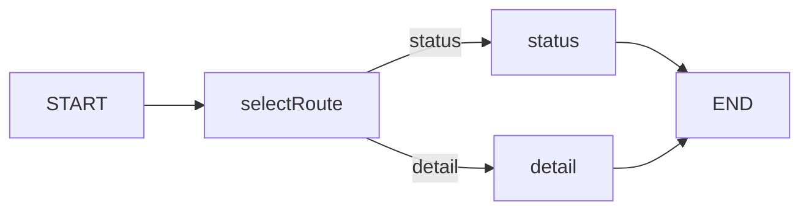

# Day 21：StateGraph、Node、Edge 与条件路由

日期：2026-11-05。状态：**COMPLETED**。前置：Day 11–15 工具执行概念。本课只学习 LangGraph 编排：输入一个演示订单查询意图，图决定“状态”或“详情”路径；不接 DeepSeek、不执行订单工具、不修改现有 SSE 问答。Day 22 再接模型和工具。

## 1. 目标与真实场景

运营系统收到“查询订单状态”或“查询订单详情”的明确任务时，不同任务应走不同节点。普通 `if` 也能处理这两个分支；本课用图的目的，是先把 **状态、节点职责、条件边、终点和运行轨迹** 看清，再为后续需要工具、审批和恢复的流程建立可观察的编排入口。



`State` 是节点共享的数据；`Node` 读取状态并返回局部更新；`Edge` 决定下一节点；`END` 结束运行。这里的 `trace` 只是演示经过哪些节点，不是生产链路追踪。

## 2. 重点代码与执行顺序

`apps/api/src/order-route-graph.ts` 使用已安装的 `@langchain/langgraph@1.7.0` 和 `Annotation.Root` 定义状态。进入图前，Zod 拒绝非法订单 ID 和意图；图内节点选择路径，条件边只允许两个已定义的目的地：

```ts
new StateGraph(GraphState)
  .addNode("selectRoute", (state) => ({ route: state.intent, trace: ["selectRoute"] }))
  .addNode("status", (state) => ({ result: `准备查询订单 ${state.orderId} 的状态`, trace: ["status"] }))
  .addNode("detail", (state) => ({ result: `准备查询订单 ${state.orderId} 的详情`, trace: ["detail"] }))
  .addEdge(START, "selectRoute")
  .addConditionalEdges("selectRoute", (state) => state.route, { status: "status", detail: "detail" })
  .addEdge("status", END)
  .addEdge("detail", END)
  .compile();
```

`trace` 字段的 reducer 会把节点返回的路径片段追加到已有数组。`runOrderRoute` 给 `.invoke` 传 `recursionLimit: 8`；当前图无循环，但提前设置上限便于理解将来循环边的保护。`apps/api/src/day21-graph.ts` 是独立命令行练习入口：

```bash
pnpm --filter @ai-native-console/api day21:graph 123 status
pnpm --filter @ai-native-console/api day21:graph 124 detail
pnpm --filter @ai-native-console/api day21:graph 123 invalid
```

前两条应分别得到 `trace: ["selectRoute","status"]` 和 `["selectRoute","detail"]`；第三条应由 Zod 拒绝。输出文本“准备查询”仅表示路由决策，**没有查询任何真实订单数据**。

## 3. 通用五大深水坑

| 深水坑 | 本课关系 |
| --- | --- |
| 流式 / Partial JSON / Generative UI | 暂不展开：图只输出最终路由结果，没有接 SSE 或模型 UI。 |
| 工具参数与自我纠错 | 相关：输入先经 Zod；本课尚未让模型生成参数或在图中执行工具。 |
| 上下文与 Token | 暂不展开：图本身不调用模型，不产生模型 Token。 |
| HITL 与副作用安全 | 相关：两个节点只返回文字计划，没有写操作或审批；不能把路由结果当执行成功。 |
| 取消、断流与恢复 | 暂不展开：命令行图无网络流或 checkpoint；设置递归上限不是恢复机制。 |

## 4. 本课专项五大深水坑

| 风险 | 触发、表现、原因 | 处理与测试 |
| --- | --- | --- |
| 非法路由值 | `intent=invalid` 导致找不到分支 | 进图前 Zod 枚举拒绝；实际命令 exit 1。 |
| 无效订单号 | `orderId=-1` 进入错误流程 | 正整数校验；实际命令 exit 1。 |
| 图没有终点 | 节点反复运行直到资源耗尽 | 两个分支都连 `END`；正常命令返回两节点 trace。 |
| 无限循环/步数失控 | 后续加入循环边但忘设上限 | `.invoke` 设置 recursionLimit；用 1 的操作触发 `GraphRecursionError`。 |
| 把路由当成查询 | 输出“准备查询”却展示成订单事实 | 本课不调用工具，文案和课件明确是计划；检查无外部请求或模型调用。 |

## 5. 实测与验收

安装 `@langchain/langgraph@1.7.0` 与其 `@langchain/core` peer 到 API 包，并核对安装包内的 `StateGraph` / `Annotation.Root` 类型示例。首次使用 `tsx` CLI 在沙箱内遇到本地 IPC `EPERM`；改用 `node --import tsx` 后无需启动服务即可运行。最终 `123 status` 和 `124 detail` 均 exit 0，分别输出 `selectRoute/status` 与 `selectRoute/detail`；`123 invalid`、`-1 status` 均因 Zod 拒绝而 exit 1；`recursionLimit=1` 触发 `GraphRecursionError`。`pnpm lint`、`pnpm -r typecheck`、`pnpm -r test`（API 15/15、Web 6/6）及 `git diff --check` 均 exit 0；现有测试不覆盖新增图。未新增 `.test.ts`，未启动项目、未运行 build、未调用 DeepSeek。

验收清单：两条合法路径各有正确的 `route/result/trace`；非法输入不进入图；过低步数上限可观察到明确错误；这份命令不产生真实订单查询或模型费用。可自己把 `intent` 改成非法值观察 Zod 错误，再把上限调回 8 比较结果。

## 6. 模拟面试

**Q1：State、Node、Edge 各负责什么？** 推荐回答：State 保存订单 ID、意图、路由和 trace；节点只更新自己负责的字段；条件边按路由选择下一节点，两个分支都到 END。本课图只给查询计划。追问：为什么不直接写 `if`？回答：目前两分支用 `if` 足够；图的价值在后续增加工具、审批、循环和恢复时能显式观察流程。错误答案：“用了图就自动有 Agent”，本课没有模型和工具。

**Q2：怎样防止图进入非法分支或无限循环？** 推荐回答：输入先由 Zod 限定意图为 `status/detail`，条件边只映射这两路，两个节点连 END，运行时还有 recursionLimit。追问：`recursionLimit=1` 能证明什么？回答：本图执行步数超限会抛 `GraphRecursionError`，并不证明所有未来图都安全。错误答案：“LangGraph 会自动理解何时停止”，必须有终点或上限。

**Q3：这张图和当前 Vercel AI SDK 各管什么？** 推荐回答：LangGraph 管节点与路径；当前 AI SDK 管 DeepSeek 请求、流式输出和工具调用。Day 21 的图尚未接 AI SDK；Day 22 才讨论模型节点和工具节点。追问：现在能根据订单状态回答用户吗？回答：不能，只输出“准备查询”的路径文本。错误答案：“图跑通说明订单工具已经接入”，混淆编排与执行。

## 7. 复盘与下一课

1. `trace` 中两个节点分别做了什么？
2. 为什么 Zod 拒绝 `invalid` 比让条件边自由处理它更清晰？
3. `END` 与 `recursionLimit` 解决的是同一个问题吗？

小练习：画出 `status` 与 `detail` 两条路径，标出哪些步骤真的执行了、哪些还只是计划。Git 建议只提交 LangGraph 依赖、图练习入口、课件和进度。Day 22 才把工具接入图；本轮停在 Day 21。
