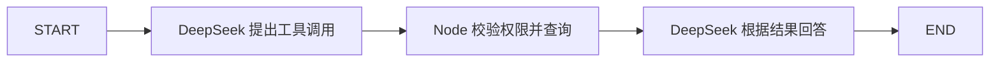

# Day 22：把 Tools 接入 LangGraph Agent

日期：2026-11-05。状态：**COMPLETED（独立命令行练习）**。前置：Day 13 服务端权限、Day 21 图路由。本课只做只读演示订单的真实 DeepSeek + LangGraph 链路，不改现有 SSE 页面，也不接写操作。

## 1. 真实场景与目标

客服问“演示订单 123 的状态是什么？”：模型负责理解问题并**提出** `getOrderDetail` 调用；Node 工具节点负责校验编号、检查演示身份范围并读取订单；回答节点只根据工具结果组织文字。这样能看清“模型决定查什么”与“业务服务决定能否查、查到什么”的分工。



本课是固定三节点、无循环的受控图。现有页面的 AI SDK 工具模式仍单独运行；图只在课程命令中调用，避免同一个请求执行两套工具流程。Day 23 才讨论 checkpoint。

## 2. 重点代码与执行

`apps/api/src/order-agent-graph.ts` 用 `StateGraph(Annotation.Root(...))` 保存问题、`toolCallId`、参数、工具结果、回答和节点轨迹。模型节点用 AI SDK `generateText` 的原生 `toolChoice` 要求模型提出 `getOrderDetail`，**没有**给 SDK 工具定义 `execute`，所以不会由 SDK 抢先执行：

```ts
const call = result.toolCalls[0];
if (!call || call.toolName !== "getOrderDetail") throw new Error("模型没有提出合法订单查询");
const toolArgs = getOrderDetailInputSchema.parse(call.input);
if (toolArgs.orderId !== Number(state.question.match(/订单\s*(\d+)/)?.[1]))
  throw new Error("模型修改了查询订单编号");
return { toolCallId: call.toolCallId, toolArgs, trace: ["model"] };
```

工具节点才调用真实执行边界：

```ts
const toolResult = await executeRegisteredTool("getOrderDetail", state.toolArgs, demoActor, signal);
return { toolResult, trace: ["tool"] };
```

`executeRegisteredTool` 仍负责白名单、Schema 和演示身份范围。回答节点第二次调用 DeepSeek，把演示工具结果转成中文回答。模型调用关闭 DeepSeek 默认思考模式、禁用 SDK 自动重试，并共享 40 秒取消信号；图运行设 `recursionLimit: 6`。`trace` 只记录节点名，尚不是生产级 span/成本追踪。

操作命令：

```bash
pnpm --filter @ai-native-console/api day22:agent '请查询演示订单 123 的状态'
pnpm --filter @ai-native-console/api day22:agent '请查询演示订单 999 的状态'
pnpm --filter @ai-native-console/api day22:agent '请查询订单状态'
```

命令读取已有 `apps/api/.env.local` 中的 DeepSeek 配置，不启动 HTTP 服务。第一个会产生真实模型用量；后两条分别验证越权和缺编号，不能被当成成功回答。

## 3. 通用五大深水坑

| 深水坑 | 本课关系 |
| --- | --- |
| 流式 / Partial JSON / Generative UI | 暂不展开：本课命令用 `generateText` 完整返回，不走 SSE 或页面组件。 |
| 工具参数与自我纠错 | 本课重点：模型参数经 Zod 和订单号一致性检查；不自动修复越权。 |
| 上下文与 Token | 相关：两次模型调用都会产生用量；没有成本仪表盘。 |
| HITL 与副作用安全 | 相关：工具仅只读，改订单仍需审批和持久幂等。 |
| 取消、断流与恢复 | 相关：模型与工具共用取消信号；无 checkpoint 或断点恢复。 |

## 4. 本课专项五大深水坑

| 失效场景 | 触发、表现与原因 | 处理和测试 |
| --- | --- | --- |
| 模型自己执行工具 | 同时给 SDK `execute` 又加图工具节点，可能重复查询 | SDK 工具只定义 Schema；图 `tool` 节点执行一次。检查真实 trace。 |
| 模型猜错订单号 | 问题缺编号或工具参数不是用户明确编号 | 缺编号进图前拒绝；参数不一致报错。缺编号命令 exit 1。 |
| 模型决定权限 | 模型提出订单 999，误以为可查询 | 注册表由 Node 校验演示身份；真实 999 请求返回 `ToolAccessError`。 |
| 无界模型工具循环 | 多次模型/工具往复放大成本 | 固定三节点到 END，`recursionLimit: 6`；检查图边。 |
| 把工具错误当答案 | 查询失败仍让回答节点生成猜测 | 工具节点抛错，图停止；999 命令无回答节点结果。 |

## 5. 实际测试与验收

实际联网调用 DeepSeek：订单 123 返回 `toolArgs={orderId:123,view:"status"}`、`toolResult={orderId:123,status:"已退款"}`、有效 `toolCallId`，回答“订单 123 的状态是：已退款”，`trace=["model","tool","respond"]`，exit 0。订单 999 的真实模型调用后被服务端工具拒绝，exit 1；缺编号由 Zod 拒绝，exit 1；直接调用未知工具返回 `ToolAccessError UNKNOWN_TOOL`。第一次真实调用因 DeepSeek 默认思考模式不支持 `toolChoice` 而失败，关闭思考模式后复测成功；沙箱内 DNS 不可用，联网环境复测成功。`pnpm lint`、`pnpm -r typecheck`、`pnpm -r test`（API 15/15、Web 6/6）及 `git diff --check` 均 exit 0；现有测试不覆盖新增图。未新增或修改 `.test.ts`，未启动项目、未运行 build。

验收清单：123 的工具参数与用户编号一致；工具结果与演示 JSON 一致；轨迹恰为三个节点；999 不生成猜测回答；缺编号不调用模型；输出中不含密钥。当前仅命令行可操作，浏览器集成和生产身份尚未实现。

## 6. 模拟面试

**Q1：模型调用工具和工具真正执行是同一步吗？** 推荐回答：不是。模型节点让 DeepSeek 产生 `toolCallId` 和参数，图的 `tool` 节点再调用 Node 注册表执行。SDK 定义里没有 `execute`，避免双重执行。追问：谁决定订单 999 能不能查？回答：服务端注册表，不是模型。错误答案：“模型返回了 tool call 就说明数据库已经查过”，混淆提议与执行。

**Q2：为什么还要校验模型给出的订单号？** 推荐回答：工具 Schema 只证明参数形式合法，不能证明编号来自用户意图。本课要求问题明确含订单号，并比对模型参数；999 还要过权限范围。追问：缺编号能让模型猜吗？回答：不能，本课在模型调用前拒绝。错误答案：“数字是正整数就可以查”，忽略业务目标和授权。

**Q3：AI SDK 与 LangGraph 在本课分别做什么？** 推荐回答：AI SDK 负责 DeepSeek 调用和原生工具提议，LangGraph 负责模型、工具、回答节点的顺序与状态，业务注册表负责权限。追问：图跑通是否等于断线恢复、审批已完成？回答：不等于；本课无 checkpoint、持久化和写操作。错误答案：“用了 LangGraph 就自动具备生产 Agent 能力”，超出已验证范围。

## 7. 复盘与下一课

1. 为什么 SDK 工具定义里不写 `execute`？
2. 订单 999 在哪个节点被拒绝，为什么不能让模型自己判断权限？
3. `toolCallId`、`toolArgs`、`toolResult` 与 `trace` 分别证明了什么？

小练习：运行 123 与 999 两条命令，画出哪一步开始出现不同结果。Git 建议只提交独立图、课程命令、课件与进度。Day 23 才讲 checkpoint 和持久化边界；本轮停在 Day 22。
